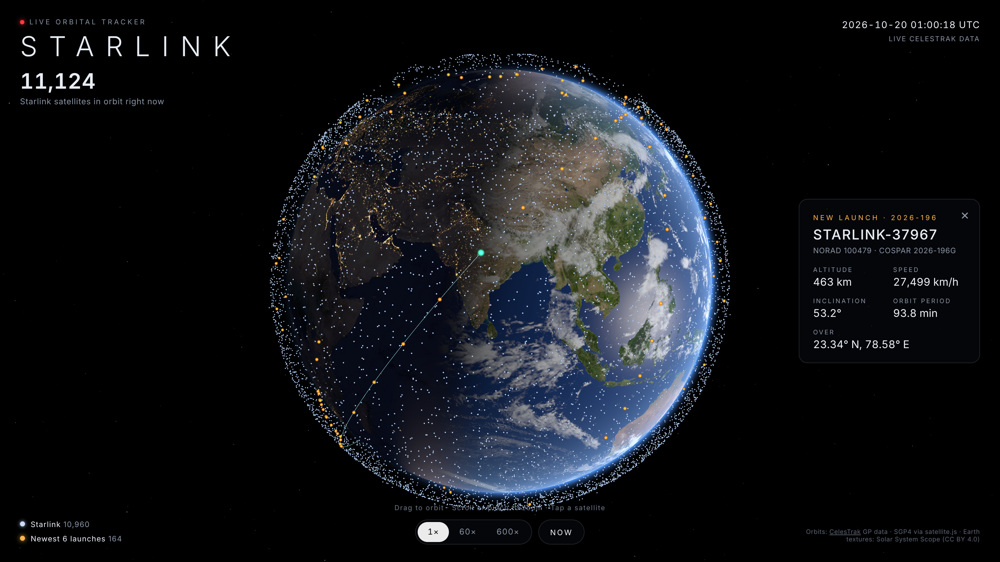

# Starlink Globe

Every Starlink satellite in its real position right now, moving live on a 3D globe.

- **Orbits:** CelesTrak GP data (`GROUP=starlink`), propagated with SGP4 ([satellite.js](https://github.com/shashwatak/satellite-js)) in a Web Worker.
- **Rendering:** three.js. One `Points` draw call for all ~11k satellites, a day/night Earth shader with city lights, clouds, and atmosphere.
- **Data path:** `/api/starlink` (Vercel function, cached at the edge for 2h), then CelesTrak directly (max once per 2h per browser), then the snapshot bundled in `public/data/starlink.json`.
- **Highlights:** the newest 6 launch groups (by international designator) are amber, so fresh launch trains stand out.

Click a satellite to see its altitude, speed, orbit trail, and position. Use 1× / 60× / 600× to speed up time.

```bash
npm install
npm run dev        # local dev
npm run snapshot   # refresh the bundled CelesTrak snapshot (skips if < 2h old)
npm run build
```

Earth textures: [Solar System Scope](https://www.solarsystemscope.com/textures/) (CC BY 4.0), via the three.js examples.



Live: https://starlink-globe.vercel.app
